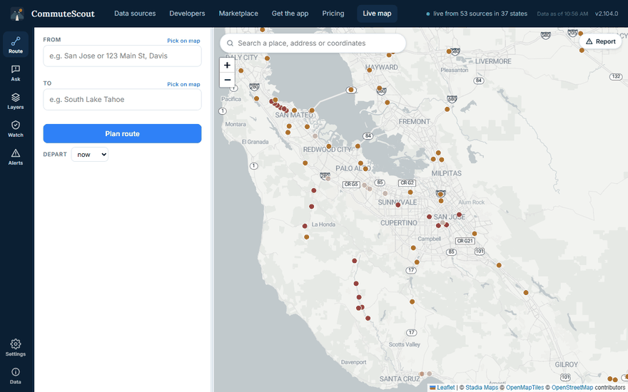

<div align="center">
  <a href="https://commutescout.com">
    
  </a>
  <h1>CommuteScout</h1>
  <p><b>Live road intelligence for 37 US states.</b><br>
  A live map, trip planning with the best time to leave, mobile apps, and a
  public MCP server and REST API for AI assistants.</p>

[](https://github.com/nicglazkov/commutescout/actions/workflows/ci.yml)
[](https://github.com/nicglazkov/commutescout/releases)
[](https://registry.modelcontextprotocol.io/v0/servers?search=io.github.nicglazkov/commutescout)
[](EVALS.md)
[](LICENSE)

  <p>
    <a href="https://commutescout.com"><b>Website</b></a> ·
    <a href="https://commutescout.com/map">Live map</a> ·
    <a href="https://commutescout.com/mcp">MCP server</a> ·
    <a href="https://commutescout.com/developers">API docs</a> ·
    <a href="https://commutescout.com/data-sources">Data sources</a> ·
    <a href="https://commutescout.com/app">Mobile apps</a>
  </p>

  <a href="https://commutescout.com">
    
  </a>
</div>

## Overview

CommuteScout reads 53 official agency feeds across **37 states** (state
DOT and 511 closures and incidents, CHP dispatch, chain controls,
cameras, message signs, wildfire perimeters, road weather, NWS alerts
and toll prices) and turns them into one live picture of the road.
Every answer carries per-source timestamps, and a failing feed is
flagged as stale rather than hidden.

| Product | What it does |
|---------|--------------|
| **[Live map](https://commutescout.com/map)** | Incidents, closures, chain controls, wildfires, about 18,000 traffic cameras, message signs and toll prices, updated continuously. |
| **[Trip planning](https://commutescout.com/map)** | Closure-aware routes, drive time for any departure, the best time to leave, and an assistant that answers from the live feeds. |
| **[Watch areas](https://commutescout.com/watch)** | Push and email alerts when something appears inside a drawn area or along a commute. |
| **[Mobile apps](https://commutescout.com/app)** | Turn-by-turn navigation for iOS and Android that announces what is ahead in your direction of travel. |
| **[MCP server](https://commutescout.com/mcp)** | 18 tools for Claude, ChatGPT, Cursor, VS Code and any MCP client. No key required. |
| **[REST API](https://commutescout.com/developers)** | Every tool as a plain HTTP GET, with an OpenAPI document, one error envelope and published rate limits. |
| **[Plugins](https://commutescout.com/plugins)** | Flare, an open protocol for adding third-party alerts to the map and the apps, with a [marketplace](https://commutescout.com/marketplace). |

## Quick start

### Connect an AI assistant

The hosted MCP server is public and works without a key:

```
https://mcp.commutescout.com/mcp
```

For example, in Claude Code:

```sh
claude mcp add --transport http --scope user commutescout https://mcp.commutescout.com/mcp
```

Setup for every other client is at
**[commutescout.com/mcp](https://commutescout.com/mcp#connect)**. Agents
can read the same steps as plain text at
[commutescout.com/llms.txt](https://commutescout.com/llms.txt).

### Call the REST API

```sh
curl "https://mcp.commutescout.com/v1/tools/best_time_to_go?origin=Union%20Station%20Denver&destination=Red%20Rocks%20Amphitheatre&day=tomorrow"
```

Keys, limits, errors and the full parameter reference are at
**[commutescout.com/developers](https://commutescout.com/developers)**.

## Documentation

| Topic | Where |
|-------|-------|
| MCP setup and tools | [commutescout.com/mcp](https://commutescout.com/mcp) · [docs/mcp.md](docs/mcp.md) |
| REST API, keys and rate limits | [commutescout.com/developers](https://commutescout.com/developers) · [OpenAPI](https://mcp.commutescout.com/v1/openapi.json) |
| Data sources and state coverage | [commutescout.com/data-sources](https://commutescout.com/data-sources) · [docs/state-coverage.md](docs/state-coverage.md) |
| Plugins and the Flare protocol | [commutescout.com/plugins](https://commutescout.com/plugins) · [docs/flare.md](docs/flare.md) |
| Architecture, deployment and adding a feed | [docs/](docs/README.md) |
| Answer quality | [EVALS.md](EVALS.md) |
| Pricing, privacy and terms | [Pricing](https://commutescout.com/pricing) · [Privacy](https://commutescout.com/privacy) · [Terms](https://commutescout.com/terms) |

## Repository

| Path | Contents |
|------|----------|
| [`src/ca_roads`](src/ca_roads) | Feed layer: parsers, caches and normalization for every source |
| [`src/ca_roads_mcp`](src/ca_roads_mcp) | MCP server, REST bridge and trip planning |
| [`src/ca_roads_demo`](src/ca_roads_demo) | Web app, assistant, watch areas and map publishing |
| [`site`](site) | Marketing and documentation site (Next.js static export) |
| [`examples/flare-plugin`](examples/flare-plugin) | Reference Flare plugin |
| [`evals`](evals) | Recorded fixtures, golden questions and the eval runner |
| [`tests`](tests) | Fixture-based test suite; runs without network access |

The mobile apps live in
[commutescout-app](https://github.com/nicglazkov/commutescout-app), and
community plugins in
[commutescout-plugins](https://github.com/nicglazkov/commutescout-plugins).

## Contributing

Contributions are welcome. Start with [CONTRIBUTING.md](CONTRIBUTING.md),
and see [adding a data source](docs/adding-a-source.md) to wire up a new
feed. Report security issues privately as described in
[SECURITY.md](SECURITY.md).

## License

[MIT](LICENSE), including the map, the planner, the MCP server and every
data parser.

CommuteScout is not affiliated with any government agency. Conditions
change faster than any feed, so verify before you drive with 511 or your
state DOT. What each third-party service sees is described in the
[privacy policy](https://commutescout.com/privacy).
